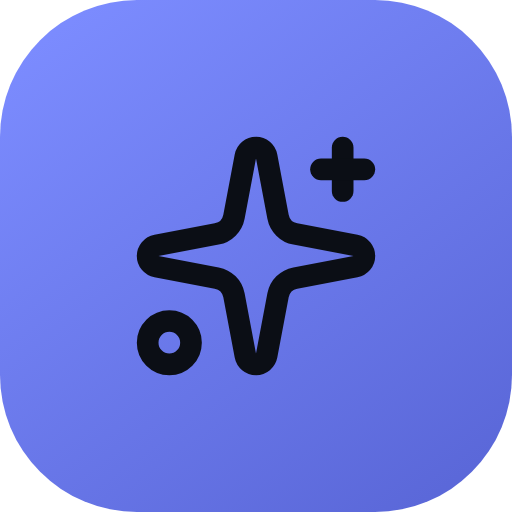
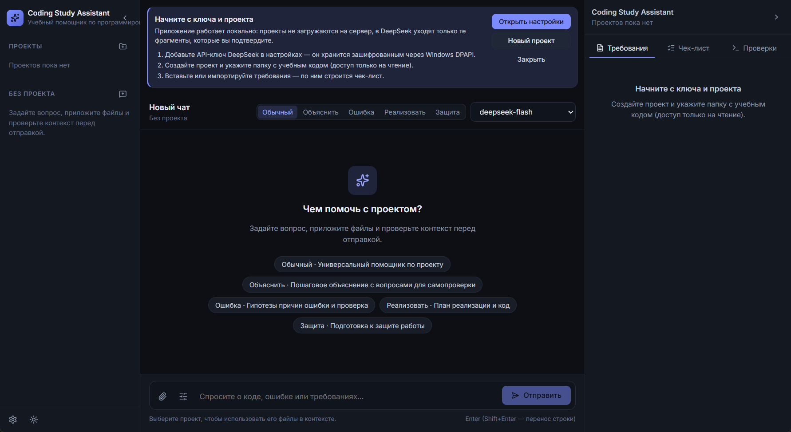

<p align="center">
  
</p>

<h1 align="center">Coding Study Assistant</h1>

<p align="center">Учебный ИИ-помощник по программированию для Windows</p>

<p align="center">
  <a href="https://github.com/Spectrbros/coding-study-assistant/releases/latest"></a>
  
  <a href="https://github.com/Spectrbros/coding-study-assistant/releases"></a>
  <a href="https://github.com/Spectrbros/coding-study-assistant/actions/workflows/release.yml"></a>
</p>

---

**Coding Study Assistant** помогает разобраться в собственном учебном проекте: объясняет код, ищет причины ошибок, подсказывает, что осталось сделать по заданию, и готовит к защите работы.

Приложение читает папку проекта **только на чтение**, хранит историю и настройки на вашем компьютере и отправляет в DeepSeek только те фрагменты кода, которые вы явно подтвердили.

<p align="center">
  
</p>
<p align="center"><em>Первый запуск: три шага, режимы помощи и выбор модели</em></p>

## 🚀 Установка

1. Откройте [Releases](https://github.com/Spectrbros/coding-study-assistant/releases/latest) и скачайте один из файлов:
   - `Coding-Study-Assistant-…-x64.exe` — обычный установщик;
   - `Coding-Study-Assistant-…-portable.exe` — версия без установки.
2. Получите API-ключ DeepSeek на [platform.deepseek.com/api_keys](https://platform.deepseek.com/api_keys). Обратите внимание: запросы к API платные.
3. Запустите приложение, откройте **Настройки**, вставьте ключ и нажмите **«Проверить и сохранить»**.

> **Windows показывает предупреждение?** Файлы не подписаны платным сертификатом, поэтому SmartScreen может их заблокировать. Нажмите **«Подробнее» → «Выполнить в любом случае»**.

> **Ключ не входит в сборку** — без него приложение не отвечает на вопросы. Также нужен доступ к интернету.

## ✨ Что умеет

- **Пять режимов помощи** — Обычный, Объяснить, Ошибка, Реализовать, Защита. Режим меняет стиль ответа под вашу задачу.
- **Контекст под вашим контролем** — найдите нужные файлы, посмотрите фрагменты и отправьте только выбранное.
- **Требования и чек-лист** — вставьте текст задания, а приложение предложит пункты и оценит, что уже сделано.
- **Проверки в один клик** — тесты и сборка запускаются в копии проекта, исходные файлы остаются нетронутыми.
- **Вложения** — текстовые файлы, PDF, DOCX и изображения можно приложить к вопросу.
- **История чатов** по каждому проекту и отдельные чаты без проекта.
- **Русский и английский интерфейс**, тёмная и светлая тема.

## 🧭 Как это работает

1. **Создайте проект** и укажите папку с учебным кодом — приложение только читает её.
2. **Добавьте требования** из задания: по ним строятся ответы и чек-лист.
3. **Выберите контекст** — что именно отправить модели, с предпросмотром.
4. **Задайте вопрос** в подходящем режиме и получите объяснение, план или разбор ошибки.

## 🔒 Приватность

- Папка проекта не изменяется: приложение не пишет, не переименовывает и не удаляет ваши файлы.
- История, настройки и требования хранятся локально, в базе на вашем компьютере.
- API-ключ шифруется средствами Windows и никогда не попадает в текст запроса.
- Сеть используется только для обращений к DeepSeek — и только с теми фрагментами, которые вы подтвердили.

## 🛠 Для разработчиков

Нужен Node.js 22.12 или новее.

```powershell
npm install
npm run dev          # запуск приложения
npm test             # unit-тесты
npm run package:win  # установщик и portable в release/
```

Релизы собираются автоматически в GitHub Actions: `npm version patch` и `git push --follow-tags` создают тег, по которому CI прогоняет тесты, собирает оба `.exe` и публикует [релиз](https://github.com/Spectrbros/coding-study-assistant/releases).

## Ограничения

- Нужен действующий ключ DeepSeek и доступ к сети.
- Проверки проекта выполняются в копии папки, но это не полноценная песочница — запускайте их осознанно.
- Поддерживается Windows 10/11 x64; другие платформы не тестировались.

---

<p align="center">
  <a href="https://github.com/Spectrbros/coding-study-assistant/releases">Скачать</a> ·
  <a href="https://github.com/Spectrbros/coding-study-assistant/issues">Сообщить о проблеме</a> ·
  <a href="https://github.com/Spectrbros/coding-study-assistant/actions">Сборки</a>
</p>
